<picture>
  <source media="(prefers-color-scheme: dark)" srcset="assets/hero-dark.svg" />
  
</picture>

  <a href="https://www.linkedin.com/in/rayonrozario/"><picture><source media="(prefers-color-scheme: dark)" srcset="assets/key-linkedin-dark.svg" /></picture></a>&nbsp;
  <a href="https://instagram.com/spikeyhelmet"><picture><source media="(prefers-color-scheme: dark)" srcset="assets/key-instagram-dark.svg" /></picture></a>

<picture>
  <source media="(prefers-color-scheme: dark)" srcset="assets/lore-dark.svg" />
  
</picture>

<picture>
  <source media="(prefers-color-scheme: dark)" srcset="assets/numbers-dark.svg" />
  
</picture>

<picture>
  <source media="(prefers-color-scheme: dark)" srcset="assets/shipped-dark.svg" />
  
</picture>

<picture>
  <source media="(prefers-color-scheme: dark)" srcset="assets/projects-dark.svg" />
  
</picture>

<picture>
  <source media="(prefers-color-scheme: dark)" srcset="assets/stack-dark.svg" />
  
</picture>

**Writing** on [meshpie.com](https://meshpie.com/author/rayon/): [Best DIY gaming PC build for ₹50k](https://meshpie.com/best-diy-gaming-pc-build-for-%e2%82%b950000/) · [Best screen recorder tools for Windows](https://meshpie.com/10-best-screen-recorder-tools-for-windows/)

<picture>
  <source media="(prefers-color-scheme: dark)" srcset="assets/footer-dark.svg" />
  
</picture>

